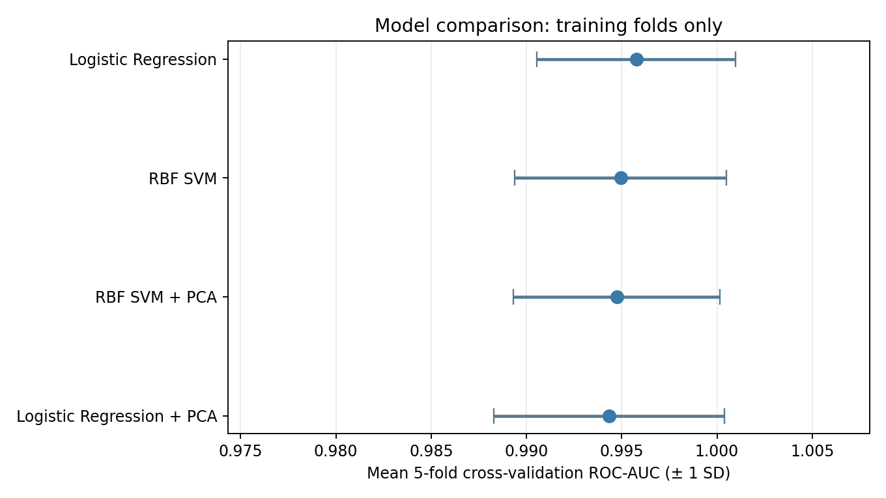
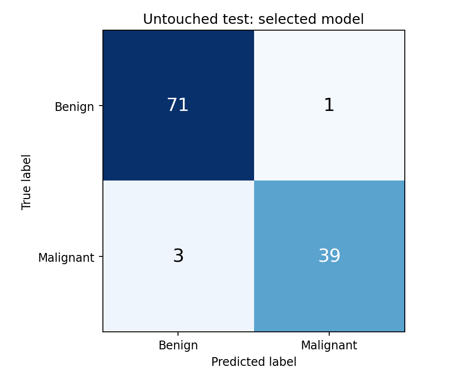
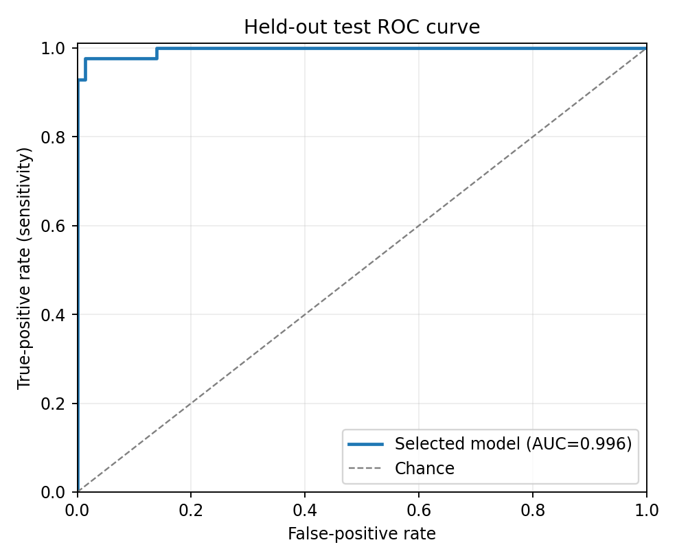

# Breast Cancer Classification with Classical Machine Learning


Compare **Logistic Regression** and **radial-basis-function Support Vector Machine (RBF SVM)** with and without **Principal Component Analysis (PCA)** using a public, pre-extracted biomedical dataset. The full experiment runs on a CPU in a few seconds and requires **no dataset download and no GPU**.

> **Scientific scope:** This is classification of **30 numerical descriptors originally extracted from digitized breast-cell nuclei images**, not classification of raw breast images or an AI medical diagnostic system. **Not for clinical use.**

## Dataset

Scikit-learn's built-in **Wisconsin Diagnostic Breast Cancer** dataset: **569 samples**, **30 numerical features**, **212 malignant**, **357 benign**. To avoid confusing class semantics, our pipeline explicitly recodes **malignant = 1**, **benign = 0** (the original scikit-learn labels are reversed).

Original source: [UCI Wisconsin Diagnostic Breast Cancer](https://archive.ics.uci.edu/dataset/17/breast+cancer+wisconsin+diagnostic). Scikit-learn loader: [load_breast_cancer](https://scikit-learn.org/stable/modules/generated/sklearn.datasets.load_breast_cancer.html).

## Protocol

1. Fix random seed 42, create one stratified **80% training / 20% held-out test** split (**455/114 samples**).
2. Compare four **pre-specified** pipelines with **5-fold stratified cross-validation on training data only**:
   - StandardScaler → LogisticRegression
   - StandardScaler → RBF SVM
   - StandardScaler → PCA (95% retained variance) → LogisticRegression
   - StandardScaler → PCA (95% retained variance) → RBF SVM
3. Fit scaling and PCA **inside** the cross-validation pipeline to prevent leakage.
4. Select model by the **highest mean CV ROC-AUC** (tie-break: balanced accuracy, then model name).
5. Refit that one model on all training data and evaluate it **once** on held-out test samples. Positive class: malignant.
6. Save metrics, test predictions, split indices, graphs, and configuration for reproducibility.

The full notebook and script implement the same pipeline, so outputs can be regenerated.

## Reproduce in 3 commands

Requires Python **3.10+** (tested with Python 3.13.5). In a terminal opened **inside this project folder**:

```bash
python -m pip install -r requirements.txt
python run.py
python -m unittest discover -s tests -v
```

For the beginner-friendly executed notebook:

```bash
jupyter notebook notebooks/Breast_Cancer_Classification_Kaggle.ipynb
```

A virtual environment is optional but recommended to avoid dependency conflicts. On Windows, use `py` instead of `python` if needed.

## Results (actual run)

**Cross-validation on training only** (mean ± sample standard deviation across 5 folds):

| Model | CV ROC-AUC | CV accuracy |
|---|---:|---:|
| Logistic Regression | **0.9958 ± 0.0052** | 97.36% |
| RBF SVM | 0.9949 ± 0.0056 | 97.14% |
| Logistic Regression + PCA | 0.9943 ± 0.0061 | **97.58%** |
| RBF SVM + PCA | 0.9947 ± 0.0054 | 97.14% |

**Selected by CV ROC-AUC:** Logistic Regression, without PCA.

**Single held-out test:** 114 observations; **accuracy 96.49%**, **ROC-AUC 0.9960**, **malignant sensitivity 92.86%**, **benign specificity 98.61%**, **malignant F1 0.9512**. The model missed **3 malignant observations**, and incorrectly classified **1 benign observation as malignant**.

These scores are descriptive for this particular small holdout, **not clinical evidence**. PCA did **not** produce a consistent gain across these fixed models. Small differences in CV are not evidence one algorithm is universally superior.

### Figures







## Folder structure

```text
breast-cancer-ml-classification/
├── README.md
├── REPORT.md
├── CV_ENTRY.md
├── CITATION.md
├── requirements.txt
├── run.py
├── src/
│   ├── __init__.py
│   └── pipeline.py
├── notebooks/
│   └── Breast_Cancer_Classification_Kaggle.ipynb
├── tests/
│   └── test_pipeline.py
├── results/
│   ├── cv_results.csv
│   ├── test_results.csv
│   ├── test_metrics.json
│   ├── test_predictions.csv
│   ├── split_indices.csv
│   └── dataset_summary.json
└── figures/
    ├── dataset_distribution.png
    ├── cross_validation_comparison.png
    ├── pca_explained_variance.png
    ├── test_confusion_matrix.png
    └── test_roc_curve.png
```

## Limitations

- This dataset supplies **numerical features rather than medical images**.
- Its loader does **not provide patient identifiers** for confirming patient-disjoint train/test splits; we cannot claim external or patient-independent validation.
- The dataset is small and relatively separable; results do not show robustness on new hospitals, devices, or populations.
- A 114-sample holdout yields uncertain estimates, and **three malignant cases were missed**.
- No hyperparameter search, probability calibration, additional external validation, or clinical deployment has been conducted. No diagnosis or treatment decisions should use the model.
