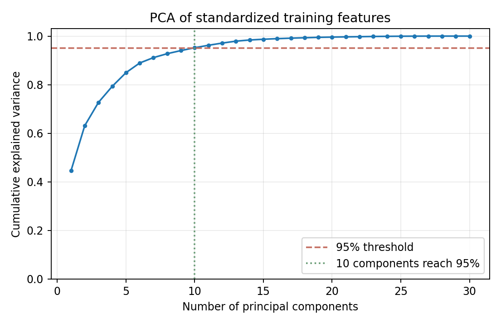

# Academic Project Report

## Title
**Comparative Analysis of Support Vector Machines and Logistic Regression for Breast Cancer Classification with Principal Component Analysis**

**Classification:** Independent Academic Project (2026)  
**Subject:** Machine Learning — supervised classification, dimensionality reduction, cross-validation

## Abstract
This introductory study compares two widely used supervised learning algorithms, Logistic Regression and a radial-basis-function Support Vector Machine (RBF SVM), for classification of malignant versus benign cases using the Wisconsin Diagnostic Breast Cancer dataset. Four fixed pipelines—with and without PCA retaining 95% of the training variance—were evaluated using five-fold stratified cross-validation on a training-only subset. The model with highest mean CV ROC-AUC was selected and assessed once on a held-out test subset. Logistic Regression without PCA was selected, achieving 96.49% test accuracy, 0.9960 test ROC-AUC and 92.86% malignant-class sensitivity on 114 samples. Three malignant cases were misclassified, illustrating why high overall accuracy does not establish clinical reliability. This is a reproducible educational benchmark on **image-derived numerical features**, not an image-based or clinically validated diagnostic tool.

## 1. Motivation and learning objectives
The project applies central course topics in supervised learning (discriminative classification with Logistic Regression and SVM), unsupervised dimensionality reduction (PCA), evaluation (cross-validation, bias from class imbalance), and reproducible biomedical-data analysis. Learning objectives are to understand preprocessing, compare fixed algorithms fairly, assess PCA's influence, and identify evaluation limitations.

## 2. Dataset
The Wisconsin Diagnostic Breast Cancer dataset distributed with scikit-learn has **569 samples**: **212 malignant** and **357 benign**. The **30 numeric features** represent cell-nuclei characteristics precomputed from digitized fine-needle-aspirate images; they include radius, texture, perimeter and area statistics. We do **not** analyze or segment the original images. Scikit-learn encodes malignant=0 and benign=1; our code explicitly reverses these labels for evaluation so that **malignant=1** is the positive class.

No hospital/site identifiers or patient-group labels are exposed by the built-in dataset loader, so patient independence cannot be verified.

## 3. Methods

### 3.1 Training and test partition
One reproducible stratified **80:20 split** using random seed **42** yields **455 training** and **114 held-out test** samples. The split is recorded by original dataset index in `results/split_indices.csv`. All model comparison and selection is performed on training samples; the test set is not used to choose models, thresholds, or PCA dimensions.

### 3.2 Fixed candidate models
Four predefined pipelines are compared:

1. StandardScaler → LogisticRegression (C=1, max_iter=3000).
2. StandardScaler → SVC (RBF kernel, C=1, gamma='scale').
3. StandardScaler → PCA (retain 95% of variance) → LogisticRegression.
4. StandardScaler → PCA (retain 95% of variance) → SVC (RBF).

**Why scale first?** A difference in feature units can substantially affect the penalty term in Logistic Regression, the RBF kernel's distance calculations, and the directions found by PCA.

**How we prevent leakage:** StandardScaler and PCA are placed *inside* sklearn Pipelines. During five-fold cross-validation, each is fitted only on that fold's training portion. No test data informs transformations or model fitting.

### 3.3 Model selection and evaluation
Five-fold stratified cross-validation with shuffling and seed 42 is applied to **training data only**. Primary metric: **mean validation ROC-AUC**, where a larger value indicates better positive-versus-negative ranking across thresholds. Secondary metrics: accuracy, balanced accuracy and malignant-class F1. Selection is deterministic: CV ROC-AUC, then balanced accuracy, then model name as tie-breaks. The winning pipeline is then fitted on all 455 training samples and evaluated **once** on the 114 reserved test samples. We report confusion counts, malignant sensitivity/precision/F1, benign specificity, accuracy, balanced accuracy and ROC-AUC.

### 3.4 Metrics
- **Accuracy:** (TP+TN)/(TP+TN+FP+FN)
- **Sensitivity / malignant recall:** TP/(TP+FN)
- **Specificity / benign recall:** TN/(TN+FP)
- **Precision (malignant):** TP/(TP+FP)
- **F1 (malignant):** 2 × precision × recall / (precision + recall)
- **Balanced accuracy:** (sensitivity + specificity)/2
- **ROC-AUC:** area under ROC curve, computed from the model's continuous decision scores.

Positive class is *malignant*. Thus a false negative is a malignant case predicted benign.

## 4. Results

### 4.1 Five-fold training-only CV

| Candidate | ROC-AUC mean | ROC-AUC SD | Accuracy mean | Balanced accuracy mean |
|---|---:|---:|---:|---:|
| Logistic Regression | **0.9958** | 0.0052 | 0.9736 | 0.9695 |
| RBF SVM | 0.9949 | 0.0056 | 0.9714 | 0.9665 |
| Logistic Regression + PCA | 0.9943 | 0.0061 | **0.9758** | **0.9712** |
| RBF SVM + PCA | 0.9947 | 0.0054 | 0.9714 | 0.9665 |

**Selected algorithm:** Logistic Regression without PCA because of the highest *mean CV ROC-AUC*. Logistic Regression + PCA had a slightly higher mean CV accuracy and balanced accuracy; choosing another metric could change the selected model. These small differences alone are not proof of algorithmic superiority.

### 4.2 Reserved test set (chosen model only)

| Metric | Test value |
|---|---:|
| Test sample count | 114 |
| Accuracy | **0.9649 (96.49%)** |
| ROC-AUC | **0.9960** |
| Balanced accuracy | 0.9573 |
| Precision, malignant | 0.9750 |
| Sensitivity, malignant | **0.9286 (92.86%)** |
| Specificity, benign | 0.9861 |
| F1, malignant | 0.9512 |

Test confusion counts: **TN = 71; FP = 1; FN = 3; TP = 39**. Put differently, three malignant cases were incorrectly labeled benign.

### 4.3 PCA and interpretation
The plot below shows how much variance each consecutive principal component explains in the **standardized training set**. The PCA experiment retains enough components to explain approximately 95% of the variance (fit separately in each CV fold). The method reduced dimensionality but did not consistently improve ranking performance on this dataset under these model settings.

## 5. Discussion
Strong discrimination on this benchmark is unsurprising: it is a relatively small, established, well-separated feature dataset. The experiment shows that a basic model can perform competitively with a more flexible nonlinear classifier. PCA sometimes alters the trade-off between ranking performance and classification accuracy, but in this comparison there is no persuasive evidence that PCA improves ROC-AUC. It is important to compare metrics, not simply identify the largest displayed percentage.

The three missed malignant cases matter because false-negative findings can be consequential in medical contexts. Neither this dataset nor this classroom experiment supports clinical decision making.

## 6. Limitations
1. **No raw medical images:** features are precalculated, so this is not an image recognition or image segmentation project.
2. **No verified patient-group split:** no group IDs were available to ensure that cases are independent at patient level; the held-out set is an internal random split, not an external site evaluation.
3. **Small test set:** 114 observations give imprecise estimates of performance, particularly for malignant sensitivity.
4. **No cross-institution validation:** no claims about different scanners, populations, or clinical settings are supported.
5. **No uncertainty intervals or inference tests:** observed score differences between classifiers should not be treated as statistically significant.
6. **Fixed models and standard decision threshold:** no targeted clinical cost sensitivity, hyperparameter search, or probability calibration were attempted.

## 7. Conclusion
Using a fixed, leakage-aware experimental protocol, we compared Logistic Regression and RBF SVM with and without PCA on an accessible biomedical dataset. Logistic Regression gave the highest mean CV ROC-AUC and was evaluated once on held-out samples, where it achieved **96.49% accuracy and 0.9960 ROC-AUC**, but missed **3 malignant observations**. The primary outcome is an auditable educational baseline illustrating careful data splitting, preprocessing, model comparison and honest evaluation—not a proposed clinical system.

## 8. Reproducibility
From the repository root run `python -m pip install -r requirements.txt`, `python run.py`, and `python -m unittest discover -s tests -v`. Use `notebooks/Breast_Cancer_Classification_Kaggle.ipynb` for an explained cell-by-cell version. Script, split indices, models, figures, and complete numerical results are included. See `results/dataset_summary.json` for software version, split details, class mapping and random seed.

## References
1. UCI Machine Learning Repository. Breast Cancer Wisconsin (Diagnostic): https://archive.ics.uci.edu/dataset/17/breast+cancer+wisconsin+diagnostic
2. scikit-learn developers. `load_breast_cancer` API: https://scikit-learn.org/stable/modules/generated/sklearn.datasets.load_breast_cancer.html
3. Pedregosa F, et al. Scikit-learn: Machine Learning in Python. *Journal of Machine Learning Research*, 2011, 12:2825–2830.
